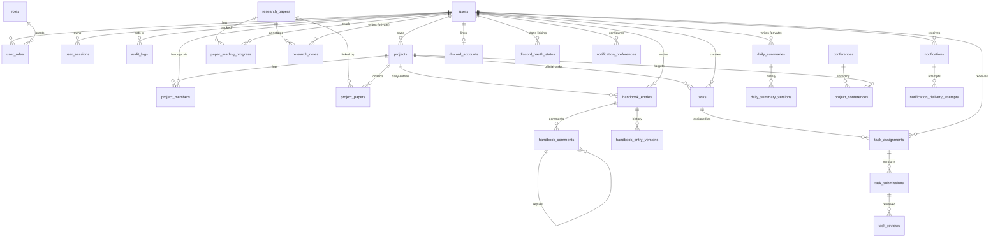

# Prism Desk — Database Documentation

PostgreSQL 17 is the single source of truth. All schema changes are Alembic migrations in
`backend/alembic/versions/`; `alembic check` reports no drift between the SQLAlchemy models and the
database. Every session runs with `timezone=UTC`; all timestamps are `timestamptz`.

## 1. Entity relationship diagram

## 2. Tables

### Authentication and administration
| Table | Purpose | Key columns / constraints |
|---|---|---|
| `users` | Accounts | UUID PK; unique `lower(username)`, `lower(email)`; `account_status` ∈ pending/approved/rejected/suspended; `approved_by/at`, `rejected_by/at`, `suspended_by/at`, `updated_at`; Argon2id `password_hash` |
| `roles` | Global roles (seeded) | Administrator, Professor, Student, Guest; unique `name` |
| `user_roles` | Many-to-many users↔roles | PK (`user_id`,`role_id`), cascades |
| `user_sessions` | Server-side sessions | SHA-256 `token_hash` (unique, raw token never stored), `expires_at`, `last_activity_at`, `revoked_at` |
| `audit_logs` | Append-only history | actor, `action`, `entity_type`, `entity_id`, sanitized JSONB `details`; trigger `trg_audit_logs_immutable` rejects UPDATE/DELETE |

### Projects
| Table | Purpose | Key columns / constraints |
|---|---|---|
| `projects` | Research projects | `status` ∈ active/archived/deleted; `owner_id` (RESTRICT), `created_by`; archive request, archive and soft-delete actor/time columns |
| `project_members` | Project-level roles (separate from global roles) | unique (`project_id`,`user_id`); `membership_role` ∈ owner/supervisor/member/guest; `membership_status` ∈ active/removed (history kept); `added_by`, `joined_at`, `removed_at` |

Supervising professors are `project_members` rows with role `supervisor`, so there is no separate
`project_supervisors` table. Guest access to a project is a `guest` membership (read-only).

### Research library (metadata only — no files)
| Table | Purpose | Key columns / constraints |
|---|---|---|
| `research_papers` | One central record per paper | partial unique index on `lower(doi)`; `authors`/`keywords` text arrays (GIN indexed); year check 1800–2200; external `url` |
| `project_papers` | Many-to-many papers↔projects | PK (`project_id`,`paper_id`) |
| `paper_reading_progress` | Per-student status | unique (`user_id`,`paper_id`,`project_id`) **NULLS NOT DISTINCT** (library-wide status uses `project_id` NULL); status ∈ not_started/reading/completed |
| `research_notes` | Private notes | always filtered by `user_id`; no API returns another user's notes |

### Tasks
| Table | Purpose | Key columns / constraints |
|---|---|---|
| `tasks` | Official and personal tasks | `task_type` ∈ official/personal; check: official ⇒ `project_id` not null; `priority`, `due_at`, `created_by` |
| `task_assignments` | Independent per-student status | unique (`task_id`,`assignee_id`); status ∈ todo/in_progress/under_review/revision_required/completed |
| `task_submissions` | Immutable submission versions | unique (`assignment_id`,`version`); `response_text`, `links` (URLs only) |
| `task_reviews` | Reviewer decisions | decision ∈ approved/revision_required; feedback |

Personal tasks get one assignment to their creator, so both task types share one workflow table.

### Research handbook
| Table | Purpose | Key columns / constraints |
|---|---|---|
| `handbook_entries` | Project-wise daily entry | unique (`student_id`,`project_id`,`entry_date`); `version` counter |
| `handbook_entry_versions` | Snapshot of every saved version | unique (`entry_id`,`version`); JSONB snapshot |
| `daily_summaries` | Overall daily summary (private) | unique (`student_id`,`entry_date`) |
| `daily_summary_versions` | Summary history | unique (`summary_id`,`version`) |
| `handbook_comments` | Supervisor comments and replies | `parent_id` self-reference (one reply level, enforced in the service) |

### Conferences
| Table | Purpose | Key columns / constraints |
|---|---|---|
| `conferences` | One record per conference edition | unique (`lower(name)`,`submission_deadline`); `important_dates` JSONB; website and CFP URLs |
| `project_conferences` | Many-to-many with archive state | PK (`project_id`,`conference_id`); `status` ∈ active/archived |

### Discord notifications
| Table | Purpose | Key columns / constraints |
|---|---|---|
| `discord_accounts` | Verified Discord link | unique `user_id`; partial unique `discord_user_id` where linked; cached DM channel; no tokens stored |
| `discord_oauth_states` | One-time OAuth state | SHA-256 `state_hash` (unique), 10-minute expiry, `used_at` |
| `notification_preferences` | Opt-outs per category | PK (`user_id`,`category`); missing row = enabled |
| `notifications` | Outbox queue | unique `dedupe_key`; status ∈ pending/processing/sent/failed/retry_scheduled; attempts, `next_attempt_at`, `last_error` |
| `notification_delivery_attempts` | Delivery log | attempt number, success, HTTP status, error |

## 3. Relationship and deletion rules
- Deleting a project is a soft delete (`status='deleted'`, `deleted_at`). Permanent deletion is
  admin-only after 90 days and cascades only project-specific rows (memberships, tasks, handbook
  entries, `project_papers`, `project_conferences`, project reading progress). Central
  `research_papers` and `conferences` rows are never removed by project deletion.
- Users are never deleted by the application (suspension is used instead). Most `*_by` actor
  columns use `ON DELETE SET NULL`; `projects.owner_id` is `RESTRICT`.
- Audit logs cannot be modified or deleted (trigger).

## 4. Indexes (beyond primary keys)
| Table | Index | Purpose |
|---|---|---|
| users | `ix_users_username_lower` (unique), `ix_users_email_lower` (unique), `ix_users_account_status` | case-insensitive login, status filters |
| user_sessions | `token_hash` unique, `ix_user_sessions_user_id`, `ix_user_sessions_expires_at` | session lookup and revocation |
| audit_logs | `ix_audit_logs_created_at`, `ix_audit_logs_entity`, `ix_audit_logs_actor`, `ix_audit_logs_action` | audit browsing and filters |
| projects | `ix_projects_status`, `ix_projects_owner_id` | dashboards, listings |
| project_members | `uq_project_members_project_user`, `ix_project_members_user_id` | membership checks on every request |
| research_papers | `uq_research_papers_doi_lower` (partial), GIN `authors`, GIN `keywords`, `publication_year` | deduplication, filters |
| project_papers | `ix_project_papers_paper_id` | reverse lookups |
| paper_reading_progress | unique (user, paper, project) NULLS NOT DISTINCT, `paper_id`, `project_id` | progress upserts and aggregates |
| research_notes | (`user_id`,`paper_id`) | owner-only note listing |
| tasks | `project_id`, `created_by`, `due_at` | task lists, reminders |
| task_assignments | unique (task, assignee), (`assignee_id`,`status`) | "my tasks", dashboards |
| task_submissions | unique (assignment, version) | versioning |
| task_reviews | `submission_id` | history |
| handbook_entries | unique (student, project, date), (`project_id`,`entry_date`) | supervisor views, progress by date |
| handbook_comments | `entry_id`, `parent_id` | threads |
| conferences | unique (`lower(name)`, deadline), `submission_deadline` | deduplication, upcoming sort |
| project_conferences | `conference_id` | reverse lookups |
| notifications | `dedupe_key` unique, (`status`,`next_attempt_at`), (`recipient_id`,`created_at`) | worker polling, history |
| discord_accounts | partial unique `discord_user_id` where linked | one Prism Desk user per Discord account |

## 5. Migration history
| Revision | Description |
|---|---|
| `1702395f628c` | create authentication tables (pre-existing) |
| `seed_global_roles` | seed predefined global roles (pre-existing) |
| `a1b2c3d4e501` | Phase 1: user moderation metadata (`rejected_*`, `suspended_*`, `updated_at`), `audit_logs` + immutability trigger |
| `a1b2c3d4e502` | Phase 2: `projects`, `project_members` |
| `a1b2c3d4e503` | Phase 3: `research_papers`, `project_papers`, `paper_reading_progress`, `research_notes` |
| `a1b2c3d4e504` | Phase 4: `tasks`, `task_assignments`, `task_submissions`, `task_reviews` |
| `a1b2c3d4e505` | Phase 5: handbook entries, versions, daily summaries, summary versions, comments |
| `a1b2c3d4e506` | Phase 6: `conferences`, `project_conferences` |
| `a1b2c3d4e507` | Phase 7: Discord accounts, OAuth states, preferences, notifications, delivery attempts |

All new migrations are additive (new tables, nullable columns, indexes). None alters or drops
existing data. They were applied to the `prism_desk` database on 2026-11-06 after a `pg_dump`
backup (`backups/prism_desk_before_phase1_20261106.dump`).
